# Въведение

## Въведение {#slide-004}

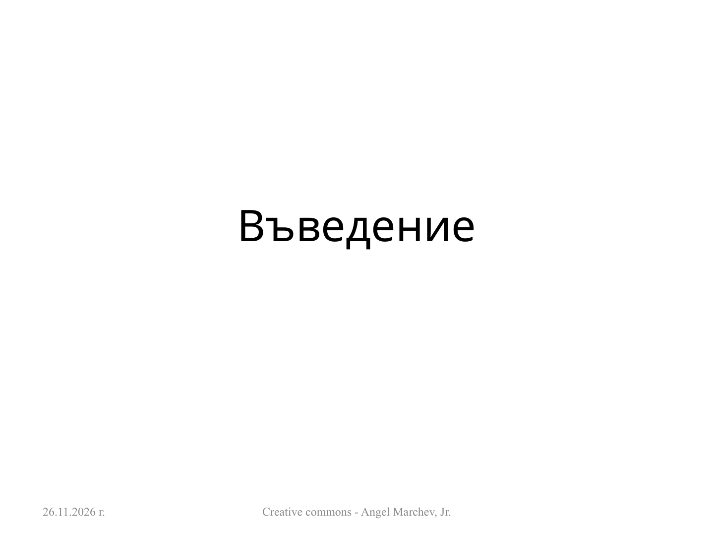{.slide}

## Слайд 5 {#slide-005}

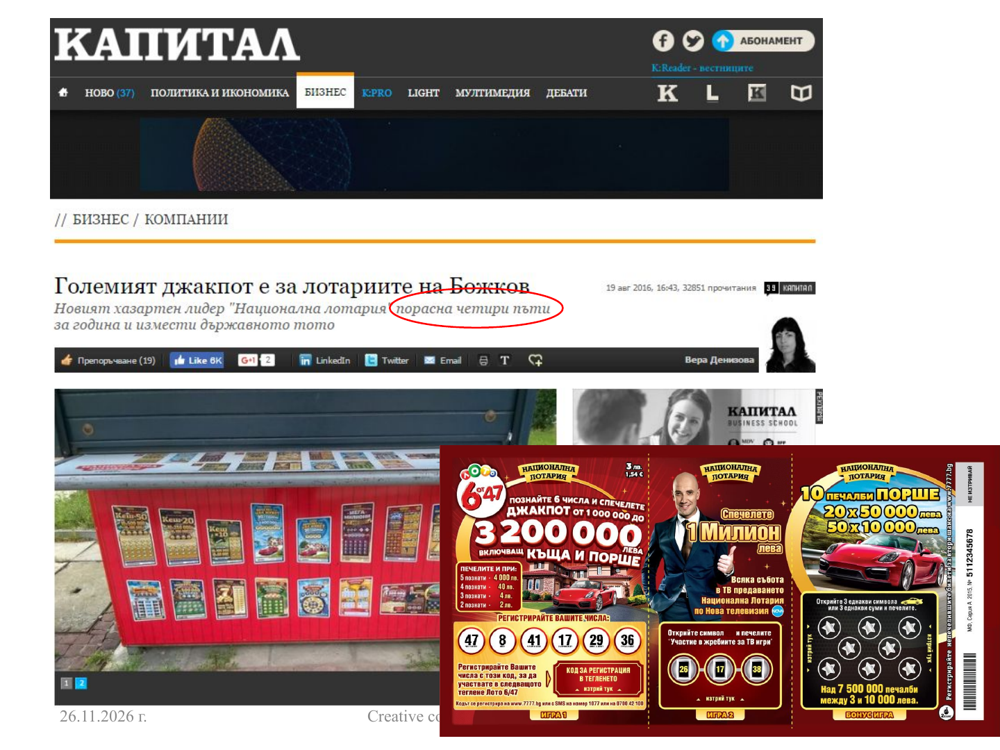{.slide}

## Слайд 6 {#slide-006}

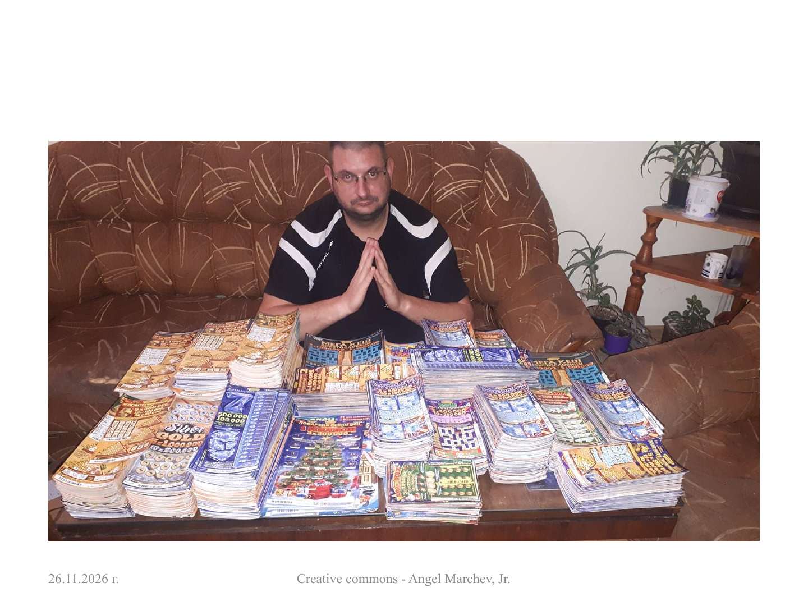{.slide}

## Слайд 7 {#slide-007}

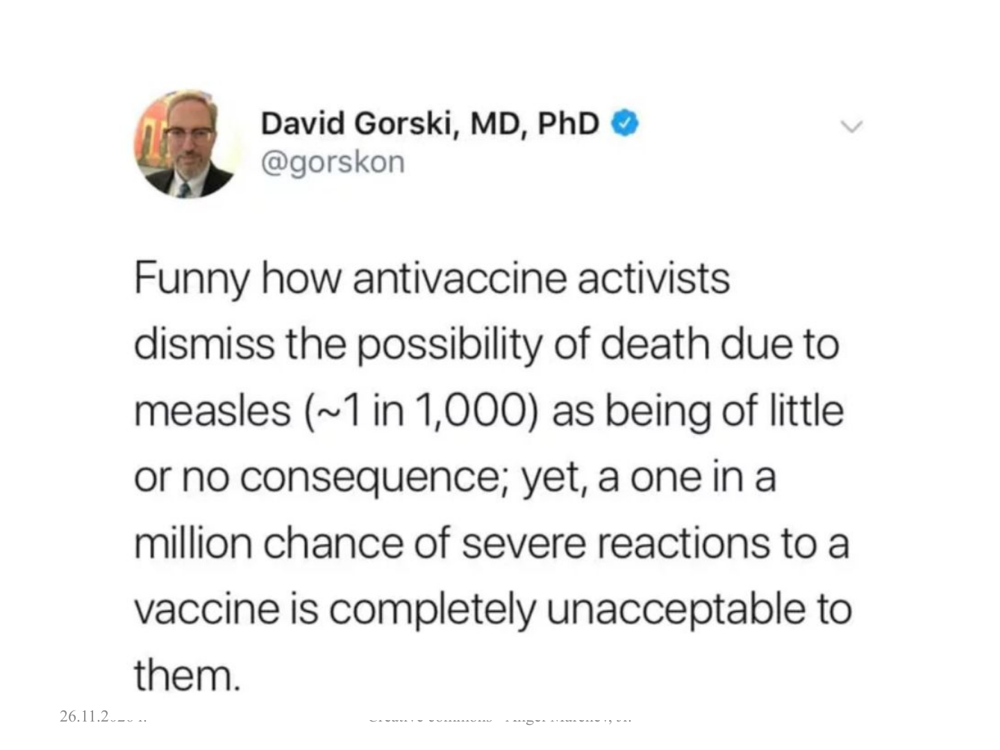{.slide}

## Слайд 8 {#slide-008}

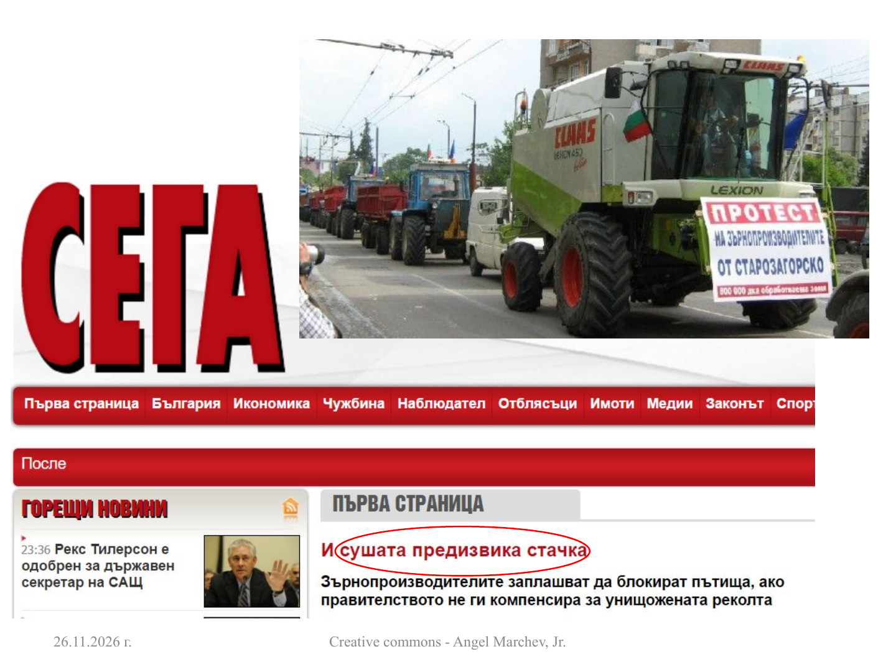{.slide}

## Слайд 9 {#slide-009}

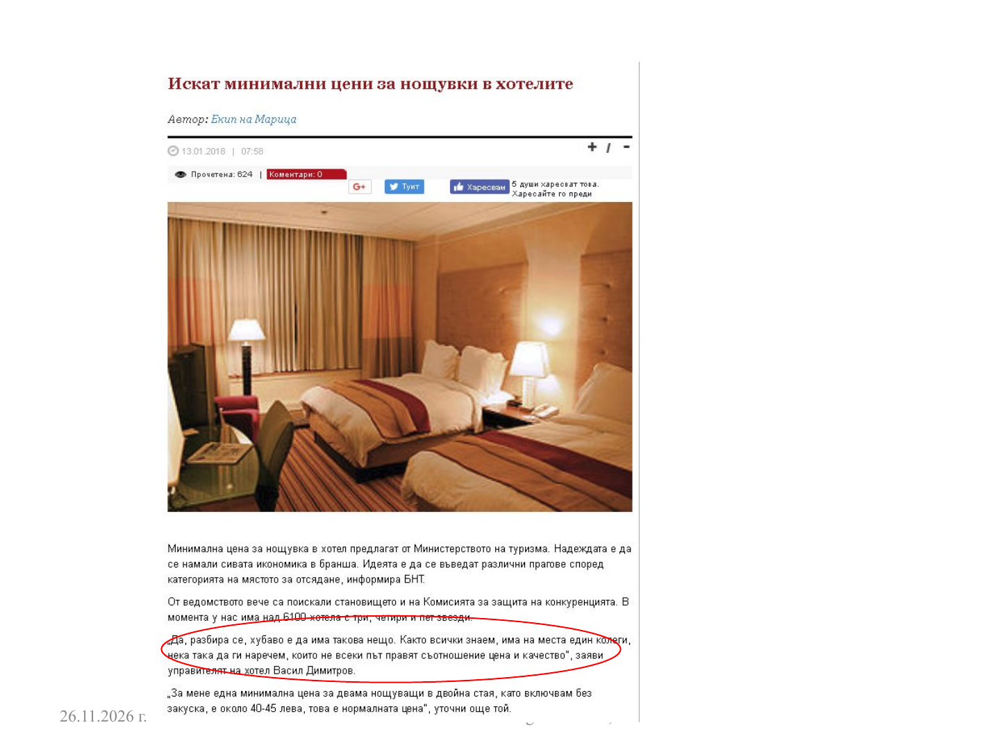{.slide}

## Слайд 10 {#slide-010}

„Трябва да има 100-процентови гаранции за безопасност [за да подкрепим ядрената енергетика]”

Януари 2013

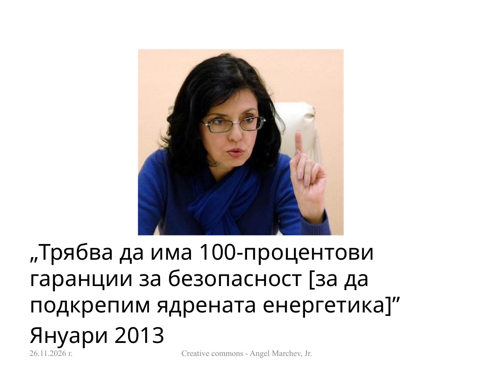{.slide}

## Юлиян Попов, 20.04.2020 {#slide-011}

[Един от проблемите] на България е, че не управлява рискове, а се бори с кризи. Когато няма криза, чака тя да дойде или си я създава, за да се бори с нея. Но не и с риска. Проблем, който болезнено се проявява в контекста на пандемията. Българското правителство е много представително за широката обществена нагласа към рисковете и кризите (то и затова е правителство, защото представлява добре тази нагласа).

Заразата не се управлява като риск, а като криза. Вместо да се отворят парковете и да се регулира движението в тях (риск), забранява се влизането в тях (криза).

Вместо да повишим стандартите на образованото (риск), даваме по 5 лева на всеки, който ще се върне (криза).

Вместо да развием превантивно здравеопазване (риск), чакаме да дойде време за операция и да режем (криза).

Вместо да се контролира движението по улиците, да се управлява риска от убийствени катастрофи, чакаме да стане трагедия и реагираме.

Никой не си застрахова имуществото срещу пожар или наводнение. Или грабеж.

Влизане и излизане от София не се регулира (риск), а се разрешава, а после блокира (криза).

Когато няма криза, а има остро чувство, че нещо не е наред, свиква се спешна кризисна конференция посред нощ, за да се каже, че всичко е ок. Спешно искаме да ви съобщим, че пожар няма. Спешно искаме да ви съобщим, че депутатите са живи и здрави. Викнахме ви в полунощ, за да ви кажем, че кокичетата още не са цъфнали, но ще цъфнат. Така е с чистотата на въздуха, хеликоптерните линейки, затлъстяването на децата, обезлюдяването не селата, купуването на бойни самолети и какво ли още не. Мисленето за риска е като страх от уроки, вместо като застрахователна полица.

Тази нагласа е дълбока. Можем да я проследим назад и да кажем, че още не сме се отърсили от икономическата криза от 1997 година. Или по-назад - в продължения на 45 години не сме си управлявали страната. Или още по-назад, отоманско време, когато никой не е знаел какво точно става, но всеки е развивал майсторство да се измъква и промъква - като Андрешко или като напускащите София. Може би още се учим да управляваме рискове. Може би живеем със суеверна надежа, че нищо не зависи от нас.

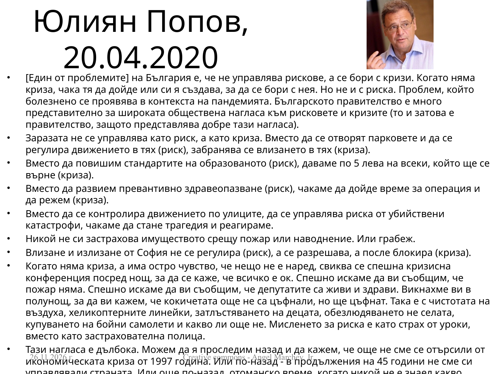{.slide}

## Стохастичен или детерминиран Свят? {#slide-012}

ТЕЗА: „Няма нищо случайно на този свят. Случайността се дължи на непознаване на съответните причинно-следствени връзки. Детерминираността или случайността на едно събитие се свежда до познавателните способности на човека“ (класическа физика, математика)

АНТИТЕЗА: „Според принципа за неопределеност на Хайзенберг съществуват събития, причинно следствените връзки на които не могат да бъдат определени в рамките на смислено за настъпването на събитието време. Този принцип означава, че съществуват събития, които не могат да бъдат направени детерминирани, в следствие на което те са непрогнозируеми. “ (квантова физика, инженерни науки)

Проф. Георги Чобанов, VSIM:16, Равда, Септември 2016

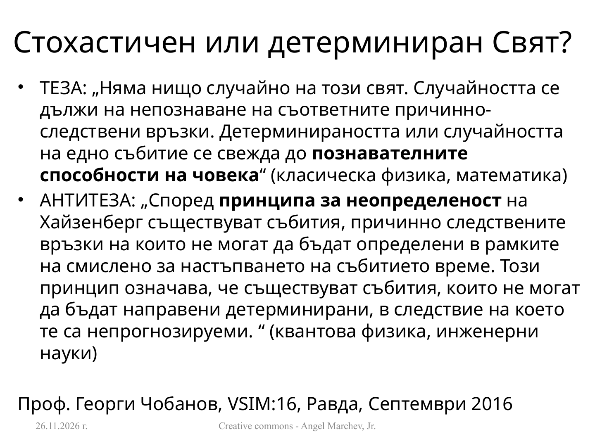{.slide}

## Стохастичен или детерминиран Свят? {#slide-013}

СИНТЕЗА (Марчев, мл.):

Или съществуват недетерминирани събития, при които причинно-следствени връзки няма;

Или познавателната способност на човека е незначимо малка в сравнение с всеобхватната Вселена/Вселени.

И в двата случая за използването на по-добрия (или единствения възможен) вероятностен математически апарат е предпочитано.

Особено валидно е за явленията със социално-психологически характер, които много повече се доближават до квантовата механика (принцип на наблюдателя, случайност (или необхватна сложност) на поведението на обектите, неопределеност на средата, непълна информация, нестационарност и пр.). Едновременно това е и по-прагматичния подход, при който винаги може да се разчита на конкретни числени резултати.“

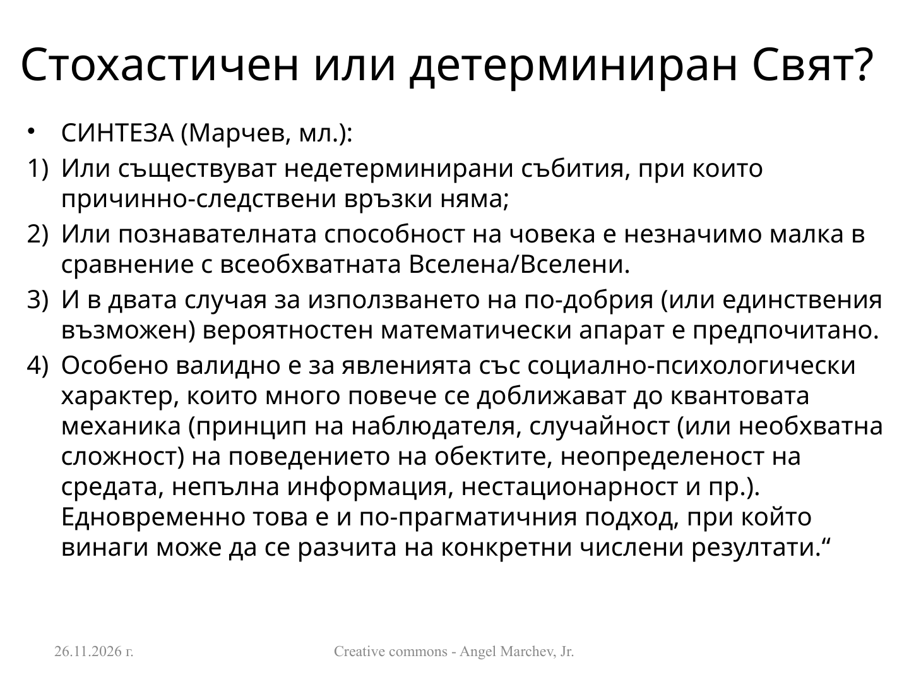{.slide}

## Ветрило на възможните реализации {#slide-014}

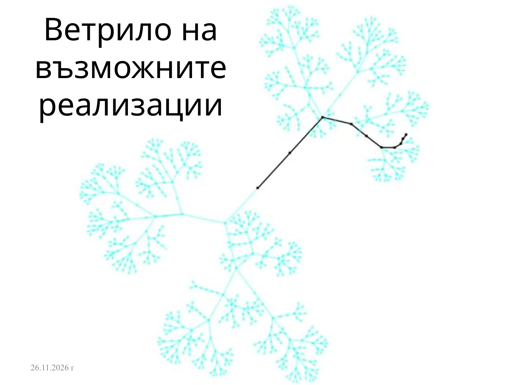{.slide}

## Ветрило на възможните реализации {#slide-015}

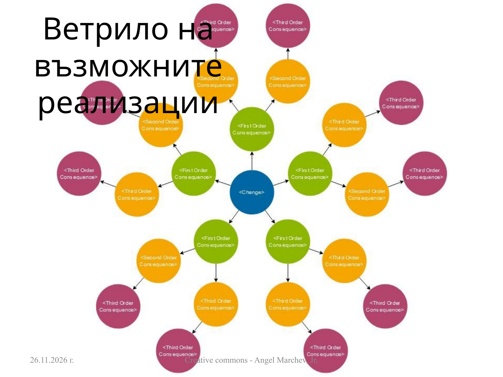{.slide}

## Поведение на реална система {#slide-016}

Marchev, Jr., Marchev

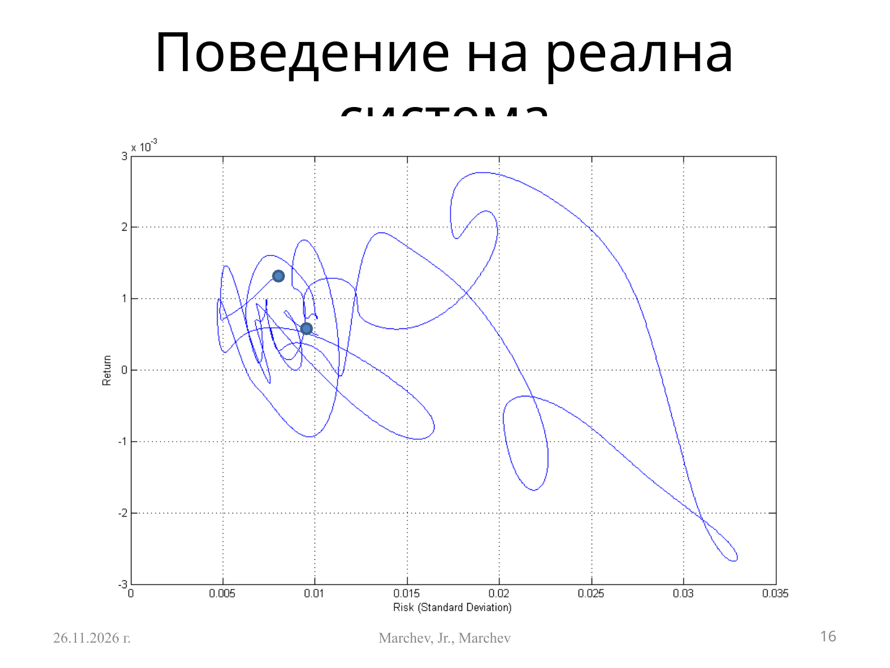{.slide}

## PRESENTATION TITLE {#slide-017}

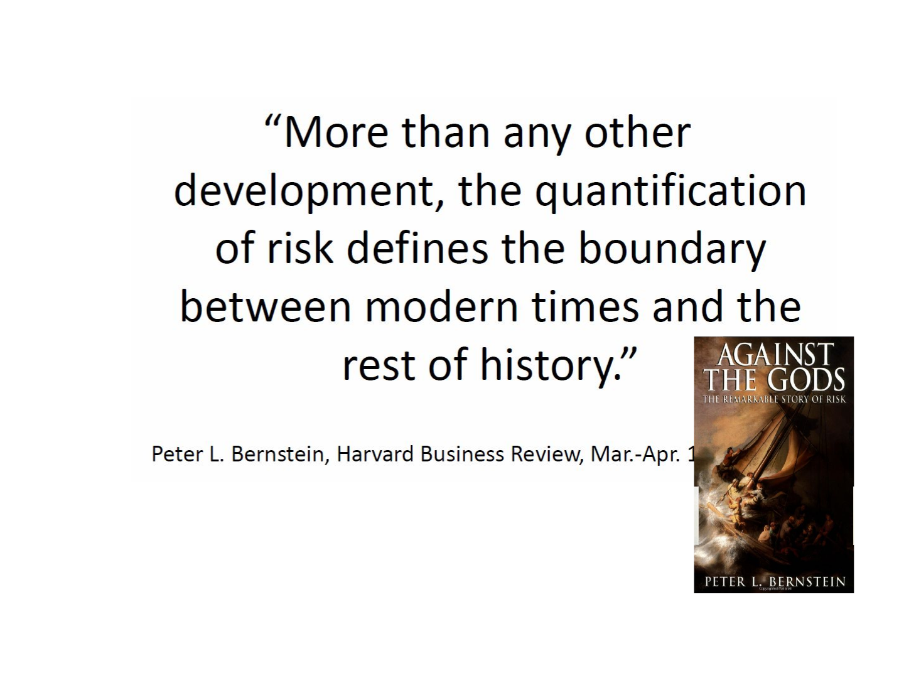{.slide}
