# Какво е РИСК?

## Какво е РИСК? {#slide-018}

Революционна идея, отбелязваща границата

между епохата на съвременния прогрес и

“мрачните” векове на миналото

Философия за обяснение на риска:

Количествен: “най-добрите решения са базирани на числа”

ИЛИ

Психологически: “решенията се базират

на очакванията за неопределеното

бъдеще”

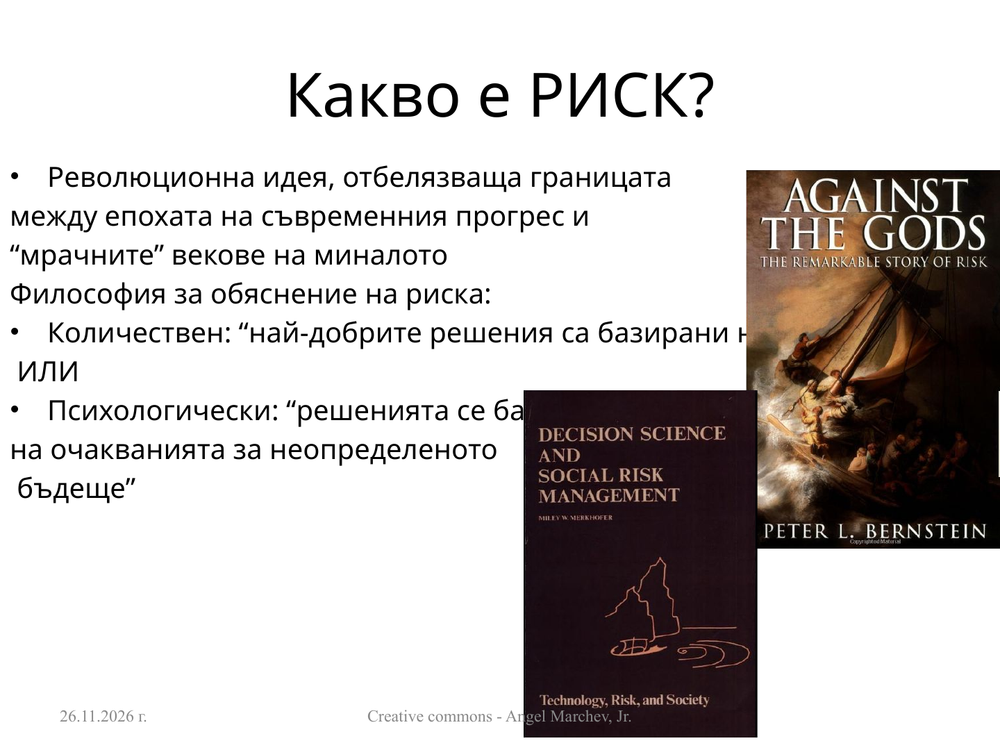{.slide}

## Angel Marchev, Jr. angel.marchev@yahoo.com {#slide-019}

The spirit of the definition of risk is captured best by the Chinese symbols for risk, which are reproduced here.

The first symbol is for “danger”, while the second is for “opportunity”, making risk a mix of danger and opportunity.

It illustrates very clearly the tradeoff that every investor and business has to make – between the higher rewards that come with the opportunity and the higher risk that has to be borne as a consequence of the danger.

Aswath Damodaran

(“INVESTMENT VALUATION”)

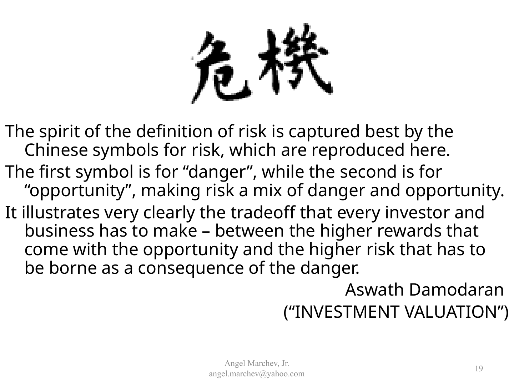{.slide}

## Етимология {#slide-020}

Ριζα (gr. “riza”) - корен, по-късно използван в Латински език за “препятствие”

risicum (lat.) специфично юридическо понятие за загуба и повреда

&quot;رزق&quot; (arab. “rizk”) – да търся успех (лат. rischio, riezgo)

risicare (it.) – да смея, посмявам

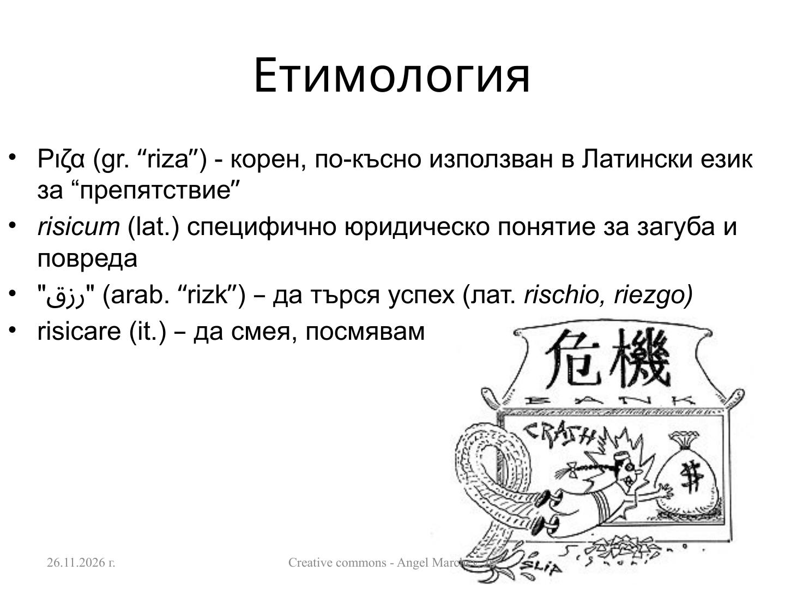{.slide}

## Какво е РИСК? {#slide-021}

Professor Risk

https://www.youtube.com/watch?v=a1PtQ67urG4

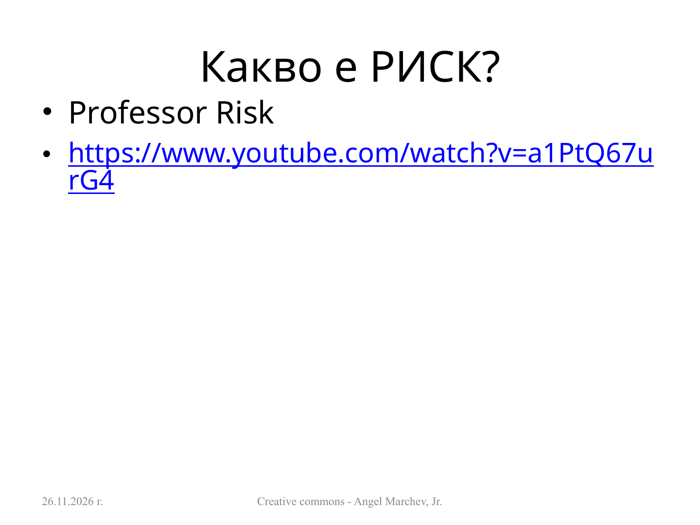{.slide}

<https://www.youtube.com/watch?v=a1PtQ67urG4>

## Какво е без-РИСК? {#slide-022}

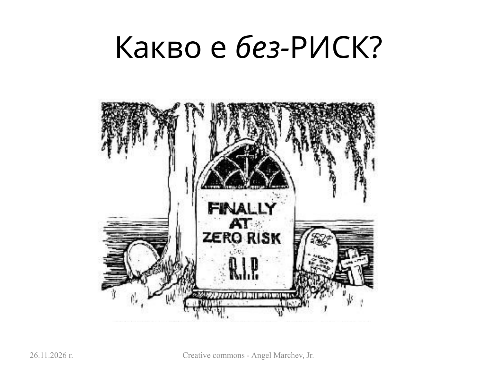{.slide}

## What is a Risk? {#slide-023}

A risk is ANYTHING that may affect the achievement of an organization’s objectives.

It is the UNCERTAINTY that surrounds future events and outcomes.

It is the expression of the likelihood and impact of an event with the potential to influence the achievement of an organization’s objectives.

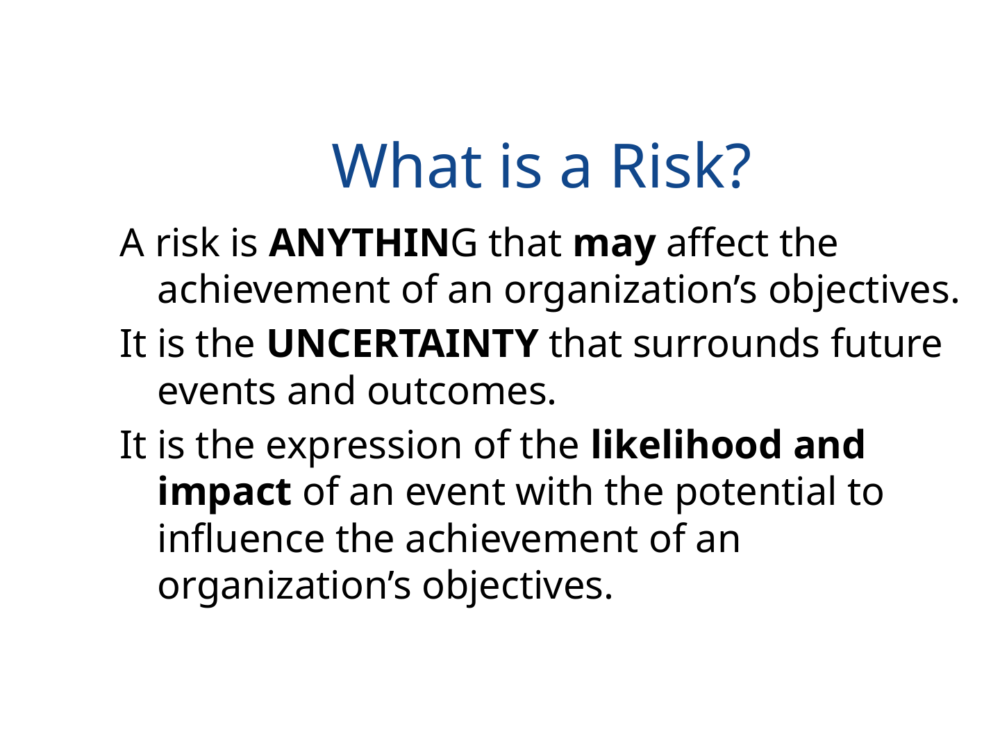{.slide}

## Alternatively … {#slide-024}

Risk is a potential event with negative consequences that had not happened yet

Could also be an event with positive consequences

A possibility of loss – not the loss itself

A source of problem

Find the root cause and not the leaves

Something that makes the project special

In the widest sense, everything is a risk

Helps identify better ways of handling problems

23

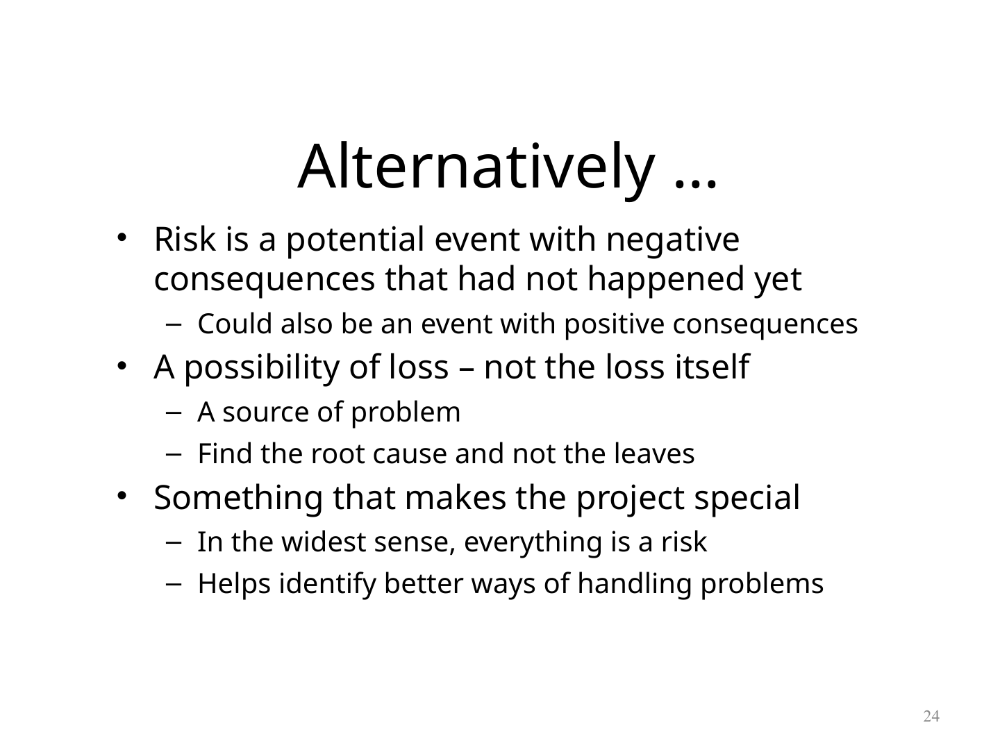{.slide}

## Key Terms {#slide-025}

Risk Tolerance – The amount of acceptable risk

Risk Adverse – Someone that does not want to take risks

Risk Factors

Probability of occurrence

Impact of event

Range of outcomes

Timing of event

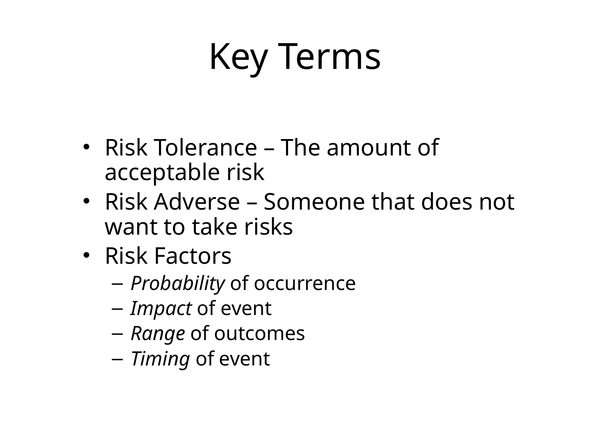{.slide}

## Categorizing Risk – Comprehensive {#slide-026}

Political  or Reputational Risk

Financial Risk

Service Delivery or Operational Risk

People / HR Risk

Information/Knowledge Risk

Strategic / Policy Risk

Stakeholder Satisfaction / Public Perception Risk

Legal / Compliance Risk

Technology Risk

Governance / Organizational Risk

Privacy Risk

Security Risk

Equity Risk

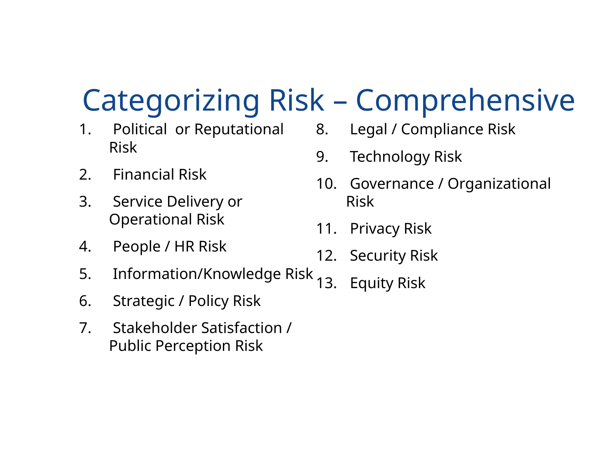{.slide}

## Diversifiable vs Non Diversifiable {#slide-027}

Diversifiable Risk

Non-diversifiable Risk

Risk that can be eliminated through diversification.

Also called Unsystematic Risk or controllable risk.

The risk inherent to the entire market or entire market segment.

Also known as &quot;systematic risk&quot; or &quot;market risk.”

It results from the occurrence of random events such as labor strikes, lawsuits, or loss of key accounts.

Business, liquidity, and default risks fall into this category.

It is assumed that any investor can create a portfolio in which this type of risk is completely eliminated through diversification.

Interest rates, recession and wars all represent sources of systematic risk because they will affect the entire market and cannot be avoided through diversification.

Whereas this type of risk affects a broad range of securities, unsystematic risk affects a very specific group of securities or an individual security.

Systematic risk can be mitigated only by being hedged.

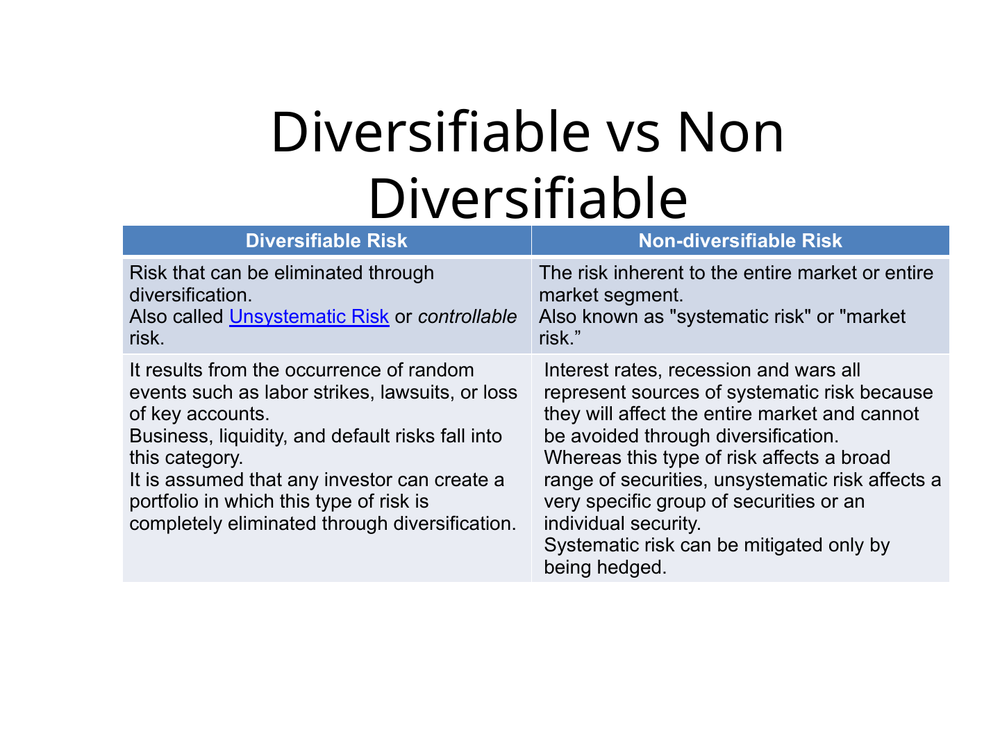{.slide}

<http://www.answers.com/topic/unsystematic-risk>

## Basic sources of risk &amp; uncertainty {#slide-028}

Known knowns (no risk/uncertainty)

Facts, outcomes or scenarios that we know with absolute certainty, based on deterministic processes

Unknown knowns

Certain facts that others know but we don’t

Based on information asymmetry or poor communication

Known unknowns

Potential facts, outcomes, scenarios that we are aware of, but don’t yet know with any certainty

Based on stochastic processes and known probability laws

Unknown unknowns

Potential facts, outcomes or scenarios that we are not yet aware of, have not even considered

Often rare and extreme events or outliers (“black swans”), not considered due to lack of experience/imagination

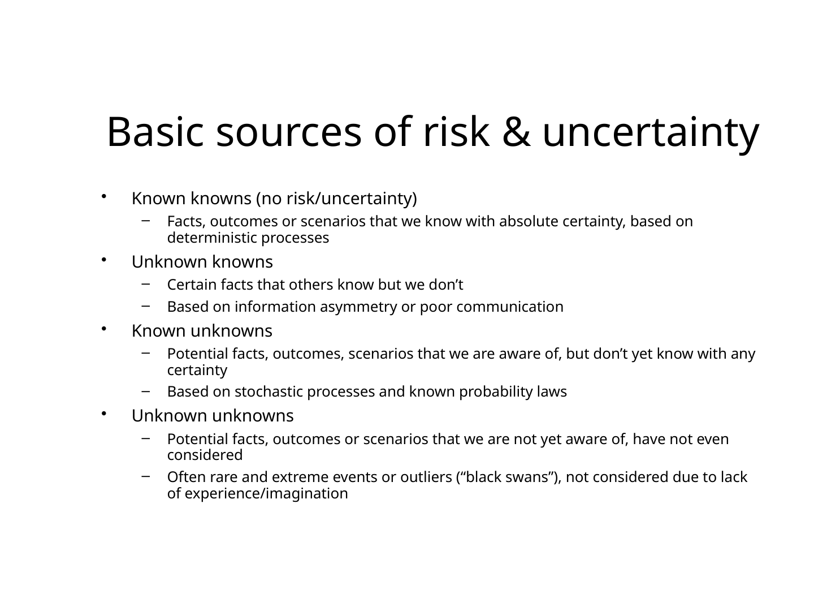{.slide}

## Variability {#slide-029}

Uncertainty occurs if at least two possible outcomes can arise out of an event.

If one possible outcome, then the outcome is known for certain, so there is no risk.

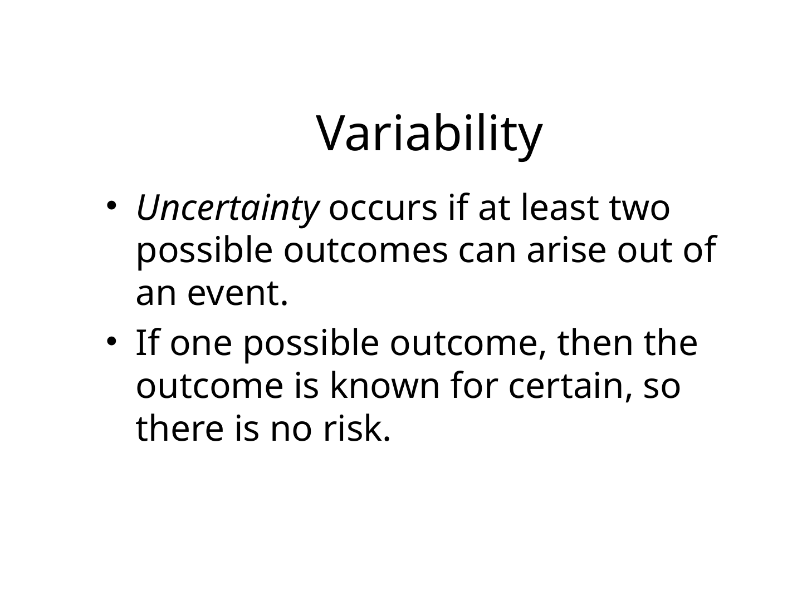{.slide}

## Variability {#slide-030}

House - two possibilities (in relation to fire):

Catch fire  or 		uncertainty exists

May not catch fire

If the house-owner certain that his house will not catch fire because it was entirely built using fire-resistant materials, then there is no risk associated with fire.

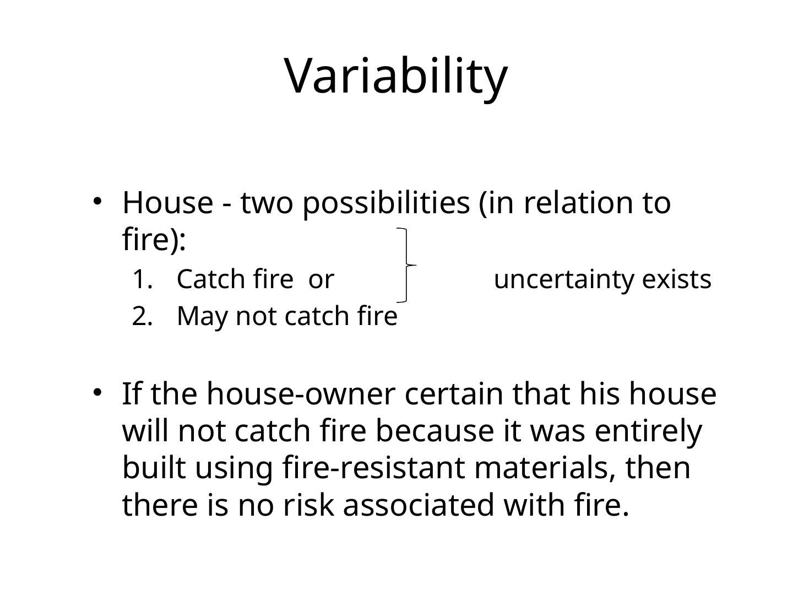{.slide}

## Variability {#slide-031}

Risk exists if there is uncertainty about the outcome of an event or an activitiy.

The greater the number of outcomes from an event, the greater would be the uncertainty and thus the risk.

E.g. fixed-return investment vs stock investment

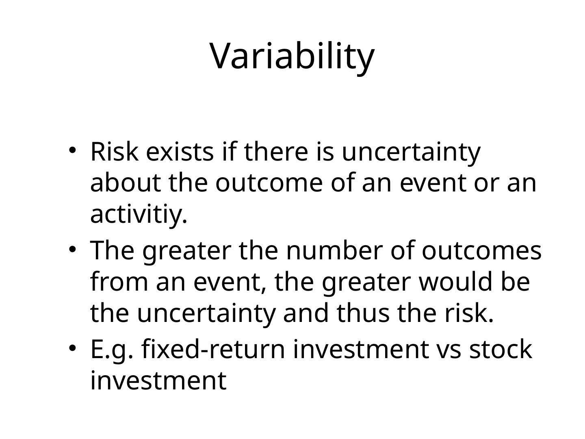{.slide}

## Какво е РИСК? {#slide-032}

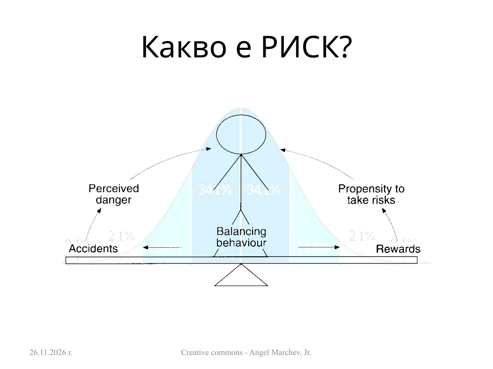{.slide}
